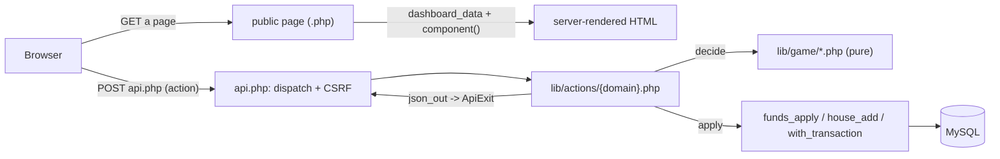

# Sharps Pick 'Em — code overview

The map of the territory: what the app does, how a request flows, the whole surface
area, and the core game loops mapped to code. Start here to rebuild your mental model.

- **Dev conventions & where to make a change** → [`CLAUDE.md`](../CLAUDE.md)
  (that file covers code that does not exist yet; **this** one is the map of what does)
- **The game rules** → `/rules` (public rulebook at `public/rules/index.html`)
- **Setup / deployment** → [`README.md`](../README.md); to launch a real league → [`OPERATIONS.md`](OPERATIONS.md)
- **Unsettled rules** → §16 of the rulebook, which is the live list; while anything is
  open, `docs/OPEN-QUESTIONS.md` sits beside it carrying the working detail. The rulebook is
  **v1.0, adopted 22 August 2026** — §16 now carries a version history and a competitive rule
  cannot change mid-season
- **The market** → *§6: TWO questions* and *The league week is the poll cycle* in
  [`CLAUDE.md`](../CLAUDE.md), plus `lib/game/order.php` and `lib/game/available.php`

---

## What it is

A LAMP web app for a family college-football **team-ownership game**. Owners buy,
sell, trade, and blind-bid on FBS teams whose "Market Value" tracks the weekly AP/CFP
polls. All money is a **virtual ledger** — the app records who owes what; the
commissioner settles real cash off-platform. Multi-league; every table is scoped by
`league_id`.

No framework, no build step. PHP 8 + MySQL + vanilla HTML/CSS/JS.

## Request lifecycle



Two entry points share `lib/bootstrap.php`, which `require`s the rest of `lib/` at its foot (`view`, `cfbd`, `battle`, `draft`, `jobs`, `mail`, `notify`, `game/*`):

- **Pages** (`dashboard.php`, `admin.php`, …) fetch their data once at the top via
  `dashboard_data($owner)` and server-render a list of **light-DOM custom elements**
  (`component('<name>', [props])`). They work with JS off. No page writes its own
  `<head>`: `page_head($title, $components, $opts)` / `page_foot()` emit the shell and
  link each named component's `index.css` / `index.js` from one list, and `asset()`
  cache-busts by mtime. The shell also carries the PWA head — manifest, theme colour,
  apple-touch-icon, favicon — so the app installs to a home screen from any page. Every
  signed-in page renders the same `<pp-topbar>` from `topbar_data($m, $page)`.
- **Mutations** POST to `public/api.php?action=X` (JSON in/out, CSRF-gated). `api.php`
  dispatches to one `lib/actions/<domain>.php` file; the handler finishes by calling
  `json_out()` (which throws `ApiExit`, caught and emitted by `api.php`).
- **Reload-on-mutation:** a component's JS calls `pp.api(action, payload)` then reloads
  so PHP re-renders. No client-side re-render, no polling — **except** the draft room,
  which polls a tiny `draft_state` endpoint. See CLAUDE.md for the component contract.
- **Pages catch their league up.** `catch_up_league()` — from `dashboard_data()`,
  `battles_data()`, `standings_data()`, `schedule_data()`, `team_data()` and `playoffs_data()` — runs six
  steps: it settles any
  due market opening, **binds** any Battle whose line has frozen, settles any whose game has
  finished, creates any the week's games imply, freezes the Prize Pool at §12's moment, and
  voids everything still open at §6's close, so all six callers are current by the time the
  first owner opens a page. **It returns an account of what each step did**, which every
  page-load caller ignores and the dev bar's step log renders. `/schedule` is the one an owner
  is most likely to open before kickoff, which is exactly when the binding step still has time
  to matter. **Binding is the urgent one** (§11, Q39): the stake is asked for once, when the
  line freezes, so a game nothing ran across is a wager that never happened. Creation is no
  longer urgent in the same way — a created Battle holds nothing until it binds — but it must
  still happen before kickoff, since nothing is created for a game already under way.
  Binding comes BEFORE settling, in both this and the hourly tick, because a Battle can only
  settle once it has bound.
  Failures are logged and swallowed — a market problem must never become somebody's 500 —
  and the hourly cron reports them properly. Only work that cannot fail for want of funds,
  cannot lose a race, and never touches the network is eligible; the CFBD syncs are not,
  and nothing here writes to `job_runs` (see CLAUDE.md for why that "no" matters).

## Surface area

### Pages — `public/*.php`

| Page | Who | What |
|---|---|---|
| `index.php` | public | retro landing / promo (the front door). Carries the one public form in the app: *Request an Invite* → `request_access` → `access_requests`, which mints nothing and notifies whoever `SIGNUP_NOTIFY_EMAIL` names (every super-admin when it is blank) |
| `login` · `join` · `forgot` · `reset` | public | auth: sign-in, invite accept, password reset. `login` also carries league selection and `<pp-league-finder>` — search listed leagues, ask to join, or start one |
| `dashboard.php` | owner | the main dashboard (portfolio, funds, market, trades, battles…) |
| `standings.php` | owner | the league scoreboard — **Alpha** ranks it, Portfolio Value beside it (§4, Q26). `?owner=N` opens that owner's portfolio and transactions; a link, not a script. Hidden from the nav and redirected to the dashboard until a week has been played (`season_week_played()`), since before that every Alpha is identical |
| `house.php` | owner | read-only House Account ledger |
| `team.php` | owner | one team's season — rank, Market Value, owner, overall, conference and against-the-spread record (`decide_team_record`), every game played and to play, and its Ownership history (the Official Record filtered to it). `?id=N`; not in the nav — every team name that has an id links here (`pp_team_link()`), except in the Draft Room |
| `schedule.php` | owner | one week of the cached FBS schedule read through this league's roster — rank, owner and line per side, away team first and home last. The column that earns the page is the last one: whether a game is a Battle, a Battle two owners are walking into, or an unranked team sitting free beside somebody's roster. `?week=N`; read-only, so acting still happens on The Market |
| `battles.php` | owner | full battle history, each with its Battle Board |
| `trades.php` | owner | full trade history; Trade Talk is league-wide, like every discussion thread (Q27) |
| `draft.php` | owner | the live snake-draft room (the one polling page) |
| `playoffs.php` | owner | the CFP bracket and what each slot paid (§12) |
| `account.php` | any user | email + display name (`<pp-identity>`), and which emails they receive — a checkbox per notification group, plus the required core that ignores them. Guarded on the USER, not a membership, so someone in no league can still reach it; the prefs pane is what needs one, and it is per membership |
| `admin.php` | commissioner | Commissioner Desk — administers ONE league (tabbed: economy, draft, teams & rankings, payouts, owners, settings, corrections) |
| `site.php` | super-admin | Site Console — administers the PLATFORM (tabbed: scheduled jobs, leagues, accounts). The Accounts tab also carries the queue of open `access_requests`, where inviting one sends the same platform invite the tab already sends. Separate page because it needs no league, and the Desk is gated on commissioning the active one |
| `home.php` | any | "back to the league" resolver — sends you to the dashboard, the league picker or the landing page. Exists so `/rules` can stay session-free and still link home |
| `api.php` | — | the single JSON endpoint |

### Components — `public/components/<name>/{index.php,css,js}`

**The list is `ls public/components/`, and is deliberately not copied here.** It was, and
went stale by four the first time anyone counted — the same failure this file warns about for
`lib/`'s helpers. What a page renders, in order, is the array it hands `page_head()`; grep
that instead of trusting a second copy.

The groups worth knowing, because they answer different questions:

- **Dashboard** — the owner's own view, and the longest list. `dashboard.php` names them.
- **Admin (`admin-*`)** — the Commissioner Desk's tabs.
- **Site Console (`site-*`)** — super-admin, league-free, deliberately wearing no topbar.
- **Shared between pages** — `record` is the clearest: the same transaction list asked
  league-wide on the dashboard or for one owner on the Desk.
- **The shell's own:** `dev-bar` — named by `page_head()` rather than by any page, because it
  belongs on all of them. The one component no page lists; see CLAUDE.md for why that is the
  exception and not a precedent.

Shared render helpers keep one idea looking like one idea across all of them.
`pp_acquire_button()` is the control that acquires a team — Add, Buy or Bid, with §8's swap
or conditional drop behind it at the team cap — drawn into whatever row is offering the
team, on the market board and on the schedule alike. Its conditions come from
`acquire_props()` and its dialogs from `<pp-acquire>`, which a page renders once; the split
is what lets a second surface offer the action without a second copy of §8's conditional
drop, and that one is money. `gate_tag()` shows **why** an action is gated — *held* (brass: it still works, it just
settles at the next opening) or *blocking* (red: genuinely refused) — because §6 and §9
mostly defer rather than refuse, and greying a control out says neither. `pp_status_tag()`
is a team's trading state: **Available · Unavailable · Held**, the third being what stops a
team another owner holds from reading as one you could get. `opening_countdown_tag()` is how
long until the next opening, in one phrasing two panels share. `info_tip()` is the ⓘ that
carries a panel's explanation, so prose stays out of the panels themselves.

### API actions — by domain (`lib/actions/`)

The `$map` at the top of `public/api.php` is the manifest; this is only the shape.

| File | Gist |
|---|---|
| `auth` | login/logout, password reset, the account's own email + display name |
| `invite` | public invite lookup + accept (`join.php`), and the super-admin's platform invites |
| `league` | switch/create/request a league; super-admin approvals, and the join requests a Commissioner answers |
| `state` | the big read model behind every page (`dashboard_data()`) |
| `owner` | queueing market orders (bid / add / drop / sell), trades, battle stake raises, fund requests, email preferences — the owner's moves |
| `commissioner` | rankings, contributions, payouts, settings, CFBD sync — and the fallbacks (`settle_battle`, `record_payout`) for what automation cannot reach |
| `comment` | Battle Board / Trade Talk / Draft Chat threads |
| `draft` | the snake-draft state machine (setup → active → complete) |
| `devtime` | dev only — moving a replayed league's clock; `lib/devtime.php` is loaded lazily and production never sees it |

The per-domain gists above are shapes, not inventories: `$map` gains actions faster than a
prose list gets updated, and it is grouped and commented already.

### Pure deciders — `lib/game/*.php` (no DB/IO, exhaustively unit-tested)

One file per rule; the caller loads the state and applies the effects. Most take a
snapshot array, but not all — see CLAUDE.md for the one signature worth reading twice.
`grep -h '^function decide_\|^function ' lib/game/*.php` is the current list; the table below
is the rules worth knowing before reading any of them, not a census.

| Decider | The rule it holds |
|---|---|
| `decide_reserve_headroom` | §11's Battle reserve — the one arithmetic behind every acquisition |
| `reserve_for` | how much §11 holds back: the stake × teams held, plus the extra games any of them play this week — and **nothing at all** once no Battle can be created, since a reserve for wagers the rules forbid secures nothing. Shared by the headroom decider and `decide_margin_call`, which is what stops the two disagreeing |
| `decide_market_order` | whether an order is allowed, and whether it EXECUTES now or queues (§6). `decide_bid_affordability` in the same file is its bidding arm, called from nowhere else |
| `decide_opening_countdown` | how long until the next opening, in the one phrasing the chip and `assets/util.js` both render |
| `decide_next_pricing_open` | WHICH MORNING the market next reprices — derived from the poll's cadence off the week's last game, and it says whether it read a scheduled opening or estimated one. Not `next_market_open()`, which knows only the hour and so points at mornings that reprice nothing |
| `resolve_bids` | the blind auction: highest wins, ties to earliest, and an owner's own ranking decides which of their wins fit under the league's team limit (§7) |
| `decide_sale` | the House buyback: whether it is allowed, and at what price (§8) |
| `decide_buyback_forecast` | how long until the next §8 boundary — exact, not a guess, since it reads the same two dates the stage does |
| `decide_calendar_warnings` | whether §8's two dates land where §8 intends — read against the CALENDAR, never the cached schedule, which lacks conference-championship week until CFBD knows who is playing and would cry wolf all season. Warns, never refuses |
| `decide_season_progress` | how far the milestone bar has filled: to the last completed moment, then interpolating toward the next by date where both ends have one and by week where they do not |
| `decide_trade_settlement` | whether a confirmed trade can complete, for BOTH owners (§9) |
| `trade_allocation` | what each traded team is recorded at — a trade re-bases, it does not re-price (§9) |
| `decide_margin_call` | whether an owner's cash covers the Battle reserve — the state, not a sweep (§11) |
| `reserve_teams_label` | the one phrasing of "N teams, one of them twice", so the reserve reads the same wherever it is explained |
| `house_will_buy` | whether §8's current buyback stage takes a team of this rank |
| `decide_battle_result` | who covered the spread (§11) |
| `decide_team_record` | a team's overall, conference and against-the-spread record for the team page; the cover is `decide_battle_result`'s, so it cannot disagree with a Battle |
| `decide_battle_settlement` | what a settled Battle pays (§11) |
| `decide_availability` | whether a team can be acted on at all — the one §6 rule |
| `decide_playoff_slots` | which payouts a finished bracket earned (§12) |
| `decide_playoff_share` | what each playoff slot is worth (§12) |

### Data model — `setup/schema.sql`

Grouped by what each answers. **Not a census** — `grep '^CREATE TABLE' setup/schema.sql` is,
and this list has been short by two before now. Each table carries its own column comments;
this is the map, they are the detail.

- **Identity:** `users` (login, shared) · `owners` (per-league membership) · `leagues`
  · `access_requests` (a stranger asking for an account, from the public landing page)
- **Config:** `settings` (k/v per league) — ONE table; `PP_LEAGUE_SETTINGS` is the allowlist, and declares each key's type, group and §16 lock
- **Teams & value:** `teams` (owner NULL = House) · `poll_cycles` (one row per published
  poll — a (week, poll) pair with its own arrival time; **this is what the market opens
  on**) · `rankings` (a full snapshot per cycle, so a team dropping out falls to unranked)
- **Economy & ledgers:** `owner_funds_ledger` · `house_ledger` (both append-only with a
  running `balance_after_cents`) · `contributions`
- **Market:** `market_openings` (one opening, `settles_at`, and `poll_cycle_id` — the poll it
  prices, NULL when it prices none; the column comment in `setup/schema.sql` is the account)
  · `market_orders` (what was
  queued for it, and what executed live)
  · `trades` (an offer under negotiation) · `transactions` (the record of what happened) · `battles`
- **Draft:** `drafts` · `draft_order` · `draft_picks`
- **Playoffs:** `payouts` · `portfolio_snapshots` (one row per owner per week — the only
  derived figure the app stores, because money events carry no week)
- **Schedule & ops:** `games` (kickoffs, lines, finals — the one CFBD cache) · `team_ratings`
  (SP+/SRS/FPI/Elo and the composite they average to — orders unranked teams on the boards,
  and is read by nothing that touches money) · `job_runs` (cron heartbeat) · `cfbd_calls`
  (one row per CFBD request — the month's API spend, which nothing else can see, and the
  429s the cooldown is derived from)
- **Social/ops:** `comments` (battle · trade · draft) · `notifications` (the outbox the
  `notify` job drains) · `notification_optouts` (which groups an owner has switched off —
  refusals only, so on is the default and needs no rows) · `invites` (league_id NULL = a
  platform invite) · `auth_tokens` · `league_requests` · `league_join_requests` ·
  `login_attempts`

### The installable shell — `public/`

Static, hand-written, no build step: `manifest.webmanifest` (installs to a home screen,
starting at `/home`, which resolves the three session states), `sw.js` (a service worker
that caches **no app content** — this is a ledger, and a cached dashboard shows money that
is wrong), `offline.html` and its precached icon, and `icons/`. A sign-in lasts
`PP_SESSION_DAYS`, which takes the cookie lifetime, `gc_maxlifetime` and an app-owned
`var/sessions` save_path together — see CLAUDE.md's security posture for why all three.

### Tooling — `bin/` + `setup/`

| Path | What |
|---|---|
| `bin/sync_schedule.php` | the only thing that asks CFBD for a game's schedule or line; fills `games`, and is the single writer of `completed` |
| `bin/sync_rankings.php` · `bin/sync_teams.php` | weekly poll + FBS roster sync |
| `bin/sync_lines.php` | every 5 minutes: re-reads the betting line for games approaching §11's 30-minute freeze, so the number a Battle settles on is not an hour stale. A no-op — one indexed query, no API call — unless something is close |
| `bin/sync_scores.php` | every 4 minutes: live points for games under way, from `/scoreboard` — the only endpoint carrying them, since `/games` answers null until a game is complete. Joined on `games.cfbd_id`. A no-op unless something is being played, and it never writes `completed` |
| `bin/settle_battles.php` · `bin/sync_battles.php` | settle §11's Battles from the frozen line, then create the week's — settling returns money that creation may need |
| `bin/settle_market.php` | run any market opening that has arrived (backstop; pages do it lazily) |
| `bin/send_notifications.php` | drain the `notifications` outbox — runs last in the hourly tick |
| `bin/sync_payouts.php` | §12's payouts from the bracket |
| `bin/fetch_season.php` | cache a real CFBD season — schedule, kickoffs, polls, closing lines, scores — into `setup/fixtures/` |
| `bin/db.php` | `status` / `reset` / `seed <scenario>` — rebuild the dev DB to a known state |
| `bin/prod_snapshot.php` | `fetch` / `verify` / `list` — rehearse a migration against a real production dump. A migration is the one change rebuilding cannot test |
| `bin/notifications.php` | read the email owners get — `list` / `show` / `render` / `queue`, and `exercise`, which plays a season and renders what it really queued. Dry run unless `--send` |
| `setup/factory.php` | builders shared by the seeder and `TestCase::makeLeague()` |
| `setup/scenarios/*.php` | `fresh` · `phases` (two leagues on the two playoff-capable seasons, left undrafted for a human to draft and then step — or played forward with `--week=`) · `replay` (one such league on its own, any year) |
| `setup/replay.php` | **the time machine.** One offset places a cached season anywhere on the real clock, and the season is played forward through the real handlers a week at a time. `PP_REPLAY_COLUMNS` classifies every datetime column as travelling with it, never travelling, or being rewritten |
| `bin/replay.php` | walk a replayed league through its season — `status` / `step` / `goto --week=N --at=…`. Forwards only; going back is a rebuild |
| `lib/devtime.php` · `public/components/dev-bar/` | the same controls in the browser, on a **development machine only**: a strip along the bottom of every signed-in page showing where the season is and moving it. The only file in `lib/` that knows `setup/` exists, and it is required lazily — production loads none of it. Two gates, either sufficient: `APP_ENV` must say `dev` (absent counts as production), and the league must carry the replay markers |
| `setup/simulator.php` · `bin/simulate.php` | the same season played by **randomised owners** against the real handlers, asserting the ledger invariants every week. The policy never knows the rules — it proposes, the handlers refuse, and the refusals are tallied by message, so a rule that stops firing is the signal. `--seasons=N` sweeps fresh seeds; a seed that fails gets pinned as its own case |
| `tests/` | PHPUnit, four layers: `Unit/` (logic) · `Rules/` (**does the app do what /rules says** — start here) · `Integration/` (wiring of the non-pure parts) · `Journey/` (user stories per phase) |

## The game, as code

The season is one loop. Each phase, with the code it lives in:

### 1 · Onboarding (a human decides every route)
**An account is only ever created by redeeming an emailed invite** — that is what makes
every password self-chosen and every address proven. `invites.league_id` splits the two
kinds: a Commissioner's `create_invite` carries a league and produces an account **and** a
membership; a super-admin's `create_platform_invite` leaves it NULL and produces an account
alone. Either way the invitee opens `join.php`, which looks the token up server-side, then
`accept_invite`.

**Before any of that there is a doorbell, and it opens nothing.** The landing page's
*Request an Invite* form posts `request_access`, which records an `access_requests` row and
notifies a super-admin. It creates no account and no membership — somebody still has to send
a real invite from the Site Console's Accounts tab, so the rule above is untouched. It exists
because the front door used to end in a sentence telling a stranger to ask their commissioner,
which is the one person they do not have.

A third route adds a membership to an account that already exists: a Commissioner switches
on `discoverable`, a signed-in user searches listed leagues and files `request_join_league`,
and `approve_join_request` calls the same `create_membership()` an invite does. Both sides
consent, which is why it does not weaken the rule above. §13 permits both routes and
closes both at the first pick: `join_refusal()` is the one predicate behind sending an
invite, redeeming one, filing a request and approving one, so a league's roster of owners
is fixed for the season the moment it drafts. New leagues go through `request_league` → super-admin
`approve_league_request` → `provision_league`.

### 2 · The Draft (preseason)
Commissioner `create_draft` → `set_draft_order` / `shuffle_draft_order` → `start_draft`.
Owners take turns (`draft_select` / `draft_pass`) in a **snake** order in `draft.php`
(polls `draft_state`, which also carries a Draft Chat marker so the room's one poll
covers both the board and the thread). Each pick moves a House team to an owner and debits their funds
into the House. Engine: `draft_*` helpers in `lib/draft.php`; tables `drafts` / `draft_order`
/ `draft_picks`.

### 3 · The Market (in-season)

**What gates an action is the TEAM, not the clock** — for as long as there is a season.
There is no postseason freeze at any point (Q18): teams keep changing hands right through
the Championship Game. After the last postseason game `season_over()` closes the market
outright, and every order kind is refused — *through* the Championship Game, not past it.
That is §6's *Close of the season*: **all** team transactions stop, trades included, and the
market does not reopen until the next preseason draft. The close is a clean cutoff —
`expire_at_season_close_quietly()` voids every unsettled order and cancels every unsettled
trade at that moment, so nothing waits for an opening that will never come.
`decide_availability()`
(`lib/game/available.php`) answers TWO questions per team, because they protect different
things:

- **available** — may the HOUSE buy, sell, add or drop it? Its last result must be priced,
  it must not be game-locked, and it must carry no live Battle. **Priced means an opening
  that carried a poll has settled since** — not merely that an opening has, because the app
  also mints openings on mornings no poll landed so an owner always has somewhere to queue,
  and those reprice nothing.
- **tradable** — may two owners trade it (§9)? Only the game-lock and the live Battle. A
  trade sets its own price, so a stale one cannot hurt either owner.

**Game-locked** runs from 30 minutes before kickoff until the game is officially final.
`decide_market_order()` turns availability into a `mode`:

- **available → it happens now.** `market_execute_now()` locks the House and the team row
  — and the team being given up, if the order names one — re-decides against them, applies
  the release before the acquisition, and writes a `done` order for each. All in one
  transaction. First owner to ask gets the team.
- **unavailable → it queues** for the next market opening (`next_market_open()`, one
  `market_openings` row per opening). Queueing is not a refusal: the owner is told which rule
  is holding the team. **Which opening actually settles it depends on what it waits on** — an
  order needing a current price is carried past any opening with no poll behind it and
  settles at the first one that reprices the board, which is the morning after a poll lands.
- **a conditional drop always queues**, available or not. What it waits on is the
  acquisition it was filed against, not the team, and that is not known until the opening.

- **Rankings drive value.** `sync_rankings_for_league()` and the `rankings` cron write a
  full snapshot per `poll_cycles` row; `market_value_cents()` recomputes MV on the fly
  (#1 = $26 … #25 = $2, unranked = **$0**). Never stored on the team.
- **Queueing** (`decide_market_order`): the season must not be over, the phase must allow
  it, the order must suit the team, one open order per team per owner, and it must leave
  §11's Battle reserve behind. The team cap (the league's own, 4–8 since Q25) binds on a
  live order and at settlement, not on a queued one — `lib/game/order.php`'s header says
  why.
- **Making room in the same breath** (§8). An owner at the cap is not stuck. On the live
  path they name a team to give up and both halves settle as one transaction — if either
  is refused, neither happens (`tests/Rules/TheSwapTest.php`). On the queued path they file
  a **conditional drop**, which is consumed only if the acquisition actually lands, so a
  lost auction or a contested free add costs them nothing. §8 states the limits on both:
  the released team must be available, unpromised and untraded, the reserve is measured on
  what the transaction leaves behind, and an unused conditional drop expires with the
  opening rather than carrying forward. Either way the team given up is SOLD to the House
  when it would buy it, and dropped for $0.00 only otherwise (`release_team_for_room()`).
- **Settlement**, in §6's order, all inside one transaction:

  ```
  1 drops → 2 sales → 3 trades → 4 bids → 5 adds → 6 Battles
  ```

  Steps 4 and 5 each consume a pending **conditional drop** when the owner is at the team
  cap; anything left unused is closed out rather than stranded.

  An order blocked only because its team is *still* unavailable rolls to the next opening
  rather than failing. The order of the six steps is load-bearing — *"THE ORDER IS THE
  DESIGN"* in `process_opening()`'s header derives it from two principles.
- **When**: lazily, by the first page load after an opening's moment arrives — from all
  four of `catch_up_league()`'s callers (see *Pages catch their league up* above), because
  each reaches settled rows without going through the dashboard — with
  `bin/settle_market.php` hourly as the backstop. Openings settle oldest-first, so one
  nobody looked at is caught up rather than orphaning its orders.
- **Trades:** `propose_trade` → counterparty `confirm_trade` → settles at once if every
  team is available, otherwise at the next opening. **No Commissioner approval** (§9, free
  market): two owners agreeing is the approval, and the cash moves owner-to-owner, never
  through the House. §9 caps a trade at **one team in each direction plus cash**, and the
  whole exchange settles together or not at all — a trade that cannot complete is *held*,
  not rejected, and rolls into the next opening. The offer lives in `trades`; settlement
  writes one `transactions` row per team that moved.
- **Battles:** written by `sync_battles_for_league()` for the current league week and never
  after kickoff, as `pending` — nothing staked, neither team held. `bind_due_battles_quietly()`
  BINDS one 30 minutes before kickoff, when the line freezes (§11, Q39): both stakes are taken
  then, and until then either owner may give the team up and the matchup dissolves. If either
  cannot cover the stake at the freeze there is no Battle and both are told; there is no
  second attempt. They **settle themselves** from the
  frozen line and the cached final score (`decide_battle_result`) — a push refunds and
  the House takes nothing. `raise_battle_stake` / `respond_battle_stake` are only the stake raise.
- **Margin Call (§11):** every owner must be able to cover a stake for every GAME their
  teams play this week — never fewer than one per team, and two for a team playing twice.
  An owner below that line is in **Margin Call** and may not increase their exposure: no
  buying, bidding, stake raises, or trades that grow their roster. Everything that reduces
  it stays open, and those are the ways out. **Nothing is ever sold or dropped on an
  owner's behalf** (Q20) — the app has no automatic route to the House at all.

### 4 · The Playoffs (postseason)
The **Prize Pool** (`prize_pool_cents`) freezes on a MOMENT, not a click: §12 makes it the
House balance "at the conclusion of the regular season", which `battles_possible()` computes,
and `catch_up_league()` snapshots it there. It locks NOTHING beyond the number — teams keep
changing hands through the Championship Game (Q18), so a payout goes to whoever owns the team
when it wins its game, and a House-owned winner's share rolls forward into the later rounds.
The snapshot exists because the House FALLS as payouts are paid: derived live, each slot would
be a share of a smaller pool than the one before it and the fifteen would not sum to the whole. `cron_sync_payouts` then reads the
bracket from the cached postseason schedule (`decide_playoff_slots`) and pays each of the
fifteen slots out of the House (`decide_playoff_share`); `record_payout` remains as the
fallback. A slot won by a House-owned team is recorded as **forfeited** and rolls into
the later rounds, so the fifteen still distribute exactly 100%. Payouts **accrue** into
Available Funds all postseason; `settle_season` then pays each owner their final balance
in one real-world payment and zeroes the ledger.

## The money model

- **Integer cents everywhere** (`*_cents`). `cents_or_fail()` parses user input and emits
  its own 400; `parse_cents()` is the one parser beneath it and returns null instead.
  `money($cents)` renders `$X.XX`. Never store MV — derive it.
- **Two append-only ledgers**, each row carrying a running `balance_after_cents`:
  - `owner_funds_ledger` — every change to an owner's Available Funds, via `funds_apply()`
    (locks the owner row, throws on overdraft unless `allow_negative`).
  - `house_ledger` — every dollar in/out of the communal House Account, via `house_add()`.
    Balance = `SUM(amount_cents)`.
- **Money flows:** `draft` / `house_purchase` → owner pays *into* the House (`add` is the
  third way a House team is acquired and the only free one, so it moves nothing). Sale → House
  pays owner Market Value in full, on §8's narrowing terms (`house_buyback_stage()`: the whole
  Top 25, then only the top twelve, then nothing) — and refuses outright when the House
  cannot cover it, first come first served (§8 — no partial buybacks, and the House never
  goes negative). **Both boundaries are dates the
  Commissioner sets before the draft** and cannot move after it; the second falls before
  conference-championship week, so the House shuts while Battles are still live. Trade cash → owner↔owner (House untouched), and a trade RE-BASES rather than
  re-prices, so a swap realizes nothing (`trade_allocation()`). Battle → stakes debited at the
  freeze, winner paid, House takes its cut. Payout → House → owner.
- **Nothing moves a team without its owner asking** (Q20). An owner below the reserve is
  in **Margin Call** and simply cannot increase their exposure until they fix it; no
  process sells or drops anything for them.
- **One helper per way a team changes hands**, shared by the opening resolver and every
  direct path so two routes cannot move the same money in subtly different ways. Teams
  LEAVE by an owner's own move through `apply_team_drop` / `apply_house_sale` (undoing a
  draft pick also releases one, and the fixtures write the pair directly); they are GRANTED
  by `apply_house_purchase`, `apply_free_add`, `apply_trade_transfer` and `draft_apply_pick`.
  Note the last one is not named `apply_*` — the grant is defined by writing `owner_id` and
  `acquired_price_cents` in one statement, which `ck_team_basis` enforces, and reading the
  name instead is how the draft came to skip §11's reserve while the check reported full
  coverage.
- **Two figures, and ALPHA is the one that wins the league** (§4, Q26). Portfolio Value is
  cash plus the Market Value of teams held — what an owner is worth, and the number they
  watch. **Alpha** is that minus what they have contributed, defined once in
  `portfolio_summary()`. `league_standings()` ranks on `alpha_cents` and uses
  `portfolio_cents` only to break ties: the two differ by contributions, so ranking on the
  portfolio would let an owner climb by depositing. Playoff winnings are already inside
  both; adding `payouts_cents` on top counts every championship twice. **A team counts at
  what the HOUSE WILL PAY for it** (§4/§8, the `$valueOf` closure) — its Market Value while
  the House is still buying it, nothing after — so by the time the field is announced the
  final table is cash against contributions.
- **Two predicates say when the football has run out**, derived on read beside
  `house_buyback_stage()` — itself just a comparison against the Commissioner's
  two dates: `battles_possible()` (releases §11's reserve, false from the
  end of conference-championship week) and `season_over()` (stops teams counting **and
  closes the market**, false until the bracket is played too). Both demand evidence of a
  cached, finished season — an empty schedule cache means "unknown", never "over".
- **`season_timeline()` is those boundaries in order**, each carrying who moves it — the
  Commissioner, the poll feed or the schedule. A LIST OF MOMENTS, NEVER A PHASE; CLAUDE.md,
  *The season has SEVERAL clocks*, is why, and it is worth reading before proposing one.
  `<pp-season>` draws the four an owner orients by; the Desk shows
  `decide_calendar_warnings()` alone, because the two moments a Commissioner controls are
  already the date fields on that screen.
- **Invariants** (enforced + tested): `check_ledger_invariants()` is the single
  definition of "the money is valid" — from the House never going negative to every
  owner's net being explained by the figures shown beside it. Every integration test
  asserts them and `bin/db.php` rolls a seed back if they fail. The list is in
  `check_ledger_invariants()` itself — deliberately not counted here, where nothing would
  catch the count drifting; CLAUDE.md, *Money invariants*, is why those properties.
  Margin Call is **reported, never enforced** at an opening: §11 tests it when the owner ACTS, so a queued order is honoured even if they fall
  below the line before it settles — the reserve itself is still re-checked there.
- **decide → apply:** the rules live in pure `lib/game/*.php` deciders and the action
  wrappers do the IO around them. CLAUDE.md, *Money core*, is the pattern to follow when
  adding one.
